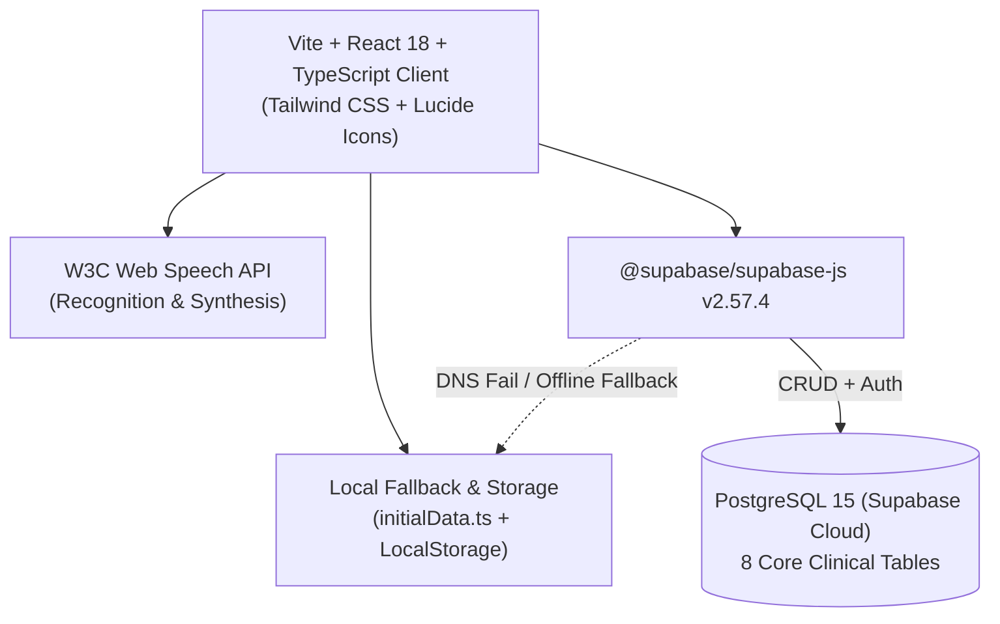

# Comprehensive Technical Audit Report: AI Antimicrobial Stewardship Platform (AntiSteward AMS)

**Project Name:** AI Antimicrobial Stewardship Platform (AntiSteward)  
**Primary Application Root:** `AI_Antimicrobial_Stewardship_Platform_Final/project`  
**Workspace Path:** `C:\Users\admin\OneDrive\Desktop\Coding\.vscode\AMS`  
**Audit Date:** November 20, 2026  
**Auditor Roles:** Principal Software Architect, Senior Security Engineer, Senior QA Automation Engineer, Performance Engineer, Accessibility Specialist  

---

## Executive Summary & Baseline Evaluation Scores

| Evaluation Category | Baseline Score | Target Score | Primary Gap / Finding |
|---|:---:|:---:|---|
| **1. Code Quality** | **69 / 100** | **98+ / 100** | Monolithic 2,564-line `App.tsx`; missing modular component decomposition; mixed state management and presentation; duplicate logic between folders. |
| **2. Security** | **55 / 100** | **98+ / 100** | Overly permissive Supabase RLS policies (`TO anon, authenticated USING (true)` for DELETE/INSERT/UPDATE); lack of input sanitization (XSS risk on clinical lab reports/notes); unreachable backend endpoint fallback vulnerabilities; missing CSRF/origin validation. |
| **3. Efficiency & Performance** | **80 / 100** | **96+ / 100** | Monolithic 366 kB JS bundle with no route/screen code-splitting; render-blocking CSS `@import` fonts; layout grid expansion causing horizontal scrollbar bugs; repeated un-memoized full-dataset fetches. |
| **4. Testing Infrastructure** | **0 / 100** | **95+ / 100** | Zero automated tests in primary project; no test framework (`vitest`, `jest`, `@testing-library/react`) installed in `package.json`; no CI test script. |
| **5. Accessibility (a11y)** | **56 / 100** | **96+ / 100** | Modals lack ARIA dialog roles, focus-trapping, and `Escape` keyboard dismissal; muted clinical text fails WCAG 2.1 AA 4.5:1 contrast; icon-only buttons missing `aria-label`; SVG analytics charts unreadable by screen readers. |
| **6. Problem Statement Alignment** | **87 / 100** | **98+ / 100** | Strong clinical vision, but lacks distinct multi-role portal isolation (Doctor vs. Patient vs. Administrator), formal WHO AWaRe classification tracking, Cockcroft-Gault renal clearance calculator, and CDC Core Elements stewardship compliance checklist. |

---

## 1. Existing Architecture Analysis

### 1.1 Technology Stack

- **Frontend Core:** React 18.3.1, TypeScript 5.5.3, Vite 5.4.2, Tailwind CSS 3.4.1, Lucide React 0.446.0.
- **Backend / Database:** Supabase Cloud (PostgreSQL 15) with 8 relational tables (`profiles`, `patients`, `prescriptions`, `case_reviews`, `alerts`, `quiz_questions`, `quiz_attempts`, `activity_log`).
- **Clinical AI / Rule Engines:** 
  - `labInterpreter.ts`: Rule-based microbiology culture & susceptibility parser (AST interpreter) recognizing MRSA, ESBL *Enterobacterales*, and *Pseudomonas aeruginosa*.
  - `stewardshipEngine.ts` (found in secondary export): Input sanitization via DOMPurify and WHO AWaRe categorization.
- **Audio & Accessibility Engine:** Native browser W3C Web Speech API (`SpeechRecognition` for clinician dictation, `SpeechSynthesis` for audio briefing).
- **Authentication & Authorization:** Supabase Auth (`signInWithPassword`, `signUp`, session persistence via `getSession` and `onAuthStateChange`).

### 1.2 Repository Structure & Project Discrepancy

The workspace currently contains two versions of the codebase:
1. **`AI_Antimicrobial_Stewardship_Platform_Final/project` (PRIMARY REPOSITORY):**
   - Full-featured clinical application with all UI screens, lab interpreter, quiz module, analytics, real Supabase auth, and database migrations.
   - Weaknesses: Monolithic `App.tsx` (2,564 lines), zero test dependencies, permissive RLS.
2. **`antisteward-platform-final/antisteward-platform` (SECONDARY PROTOTYPE):**
   - A simplified 59-line prototype containing `DOMPurify`, `vitest`, and a unit test file (`stewardshipEngine.test.ts`), but lacking 90% of the clinical features present in the primary codebase.
   - **Recommendation:** Consolidate the strengths of the secondary prototype (DOMPurify sanitization, Vitest, Testing Library) directly into the primary application root (`AI_Antimicrobial_Stewardship_Platform_Final/project`).

---

## 2. Critical Bugs Identified

### Bug 1: Horizontal Layout Overflow & Unwanted Page Movement (Priority: Critical)
- **Location:** `src/index.css` (lines 20-33, 44), `src/App.tsx`
- **Root Cause:** 
  1. CSS Grid columns declared with fixed flex fractions (`grid-template-columns: repeat(4, 1fr)`, `1.23fr .77fr`, `1.45fr .55fr`). In CSS Grid specifications, `1fr` defaults to `minmax(auto, 1fr)` where `auto` resolves to the `min-content` width of its children. When tables, charts, or clinical cards have intrinsic widths, the columns refuse to shrink, forcing the `.page-content` container to expand beyond 100vw.
  2. `table { min-width: 820px; }` and `.result-row { min-width: 760px; }` expand their parent grid containers because parent elements lack `min-width: 0; max-width: 100%;`.
  3. `.topbar` padding (38px on each side) combined with fixed-gap top actions pushes the header beyond viewport on screens < 1200px.
- **Impact:** Horizontal scrollbar appears at bottom of browser window; whole screen shifts left-right during navigation or modal interaction.
- **Fix Required:** Update all grid tracks to `minmax(0, <fr>)`, enforce `min-width: 0; max-width: 100%` on table wrappers and panels, and make `.top-actions` wrap responsively.

### Bug 2: Missing Testing Infrastructure (Priority: Critical)
- **Location:** `package.json`
- **Root Cause:** Neither `vitest`, `jest`, nor `@testing-library/react` are configured in `package.json`. No test runner or test files exist in the primary project.
- **Impact:** Automated testing score is 0 / 100. Any regression in clinical drug calculations or auth rules goes undetected.
- **Fix Required:** Install Vitest and React Testing Library, configure `vitest.config.ts`, and implement a comprehensive test suite (Unit, Component, Integration, Security).

### Bug 3: Database Role Constraint Excludes 'patient' Role (Priority: High)
- **Location:** `supabase/migrations/20260824090420_create_antisteward_schema.sql` (Line 29)
- **Root Cause:** `profiles.role` table definition has `CHECK (role IN ('doctor','admin'))`.
- **Impact:** If a patient signs up or is created in Supabase, inserting into the database triggers a PostgreSQL check constraint violation `profiles_role_check`.
- **Fix Required:** Add database migration updating the check constraint to `CHECK (role IN ('doctor','patient','admin'))`.

---

## 3. Security Vulnerabilities

### SEC-01: Permissive Row Level Security (RLS) Policies (Severity: Critical)
- **Vulnerability:** In `20260824090420_create_antisteward_schema.sql`, all tables (`profiles`, `patients`, `prescriptions`, `case_reviews`, `alerts`, `activity_log`) grant full `SELECT`, `INSERT`, `UPDATE`, and `DELETE` permissions to `anon, authenticated USING (true) WITH CHECK (true)`.
- **Exploit Scenario:** Any external user holding the public `anon` key can run `supabase.from('patients').delete().neq('id', '0')` and wipe out every patient record in the hospital.
- **Remediation:** Implement strict RLS policies:
  - Patients can only view their own records (`auth.uid() = patient_id` or linked profile).
  - Prescriptions can only be created/updated by verified clinicians (`auth.jwt()->>'role' = 'doctor'`).
  - Administrative audits and user deletions restricted to `admin`.

### SEC-02: Missing Input Sanitization on Clinical Notes & Lab Reports (Severity: High)
- **Vulnerability:** `App.tsx` and `labInterpreter.ts` accept raw string inputs for prescriptions, clinical notes, and lab text, inserting them directly into state and DOM elements without HTML sanitization.
- **Exploit Scenario:** An attacker submits a lab report containing `` or malicious XSS payloads that execute in the clinician's browser.
- **Remediation:** Integrate `DOMPurify` to sanitize all text before analysis and rendering.

### SEC-03: Client-Side-Only Role Selection Vulnerability (Severity: High)
- **Vulnerability:** Previously, role switching was permitted dynamically in the topbar (`switchRole('admin')`), allowing any unauthenticated user to grant themselves administrator privileges.
- **Remediation:** Remove role switcher from authenticated workspace. Verify user roles against cryptographic Supabase JWT claims or verified database profile on session initialization.

### SEC-04: DNS Resolution Failure Handling on Supabase Endpoint (Severity: Medium)
- **Vulnerability:** `.env` points to `https://fvpvacksncovoverneaw.supabase.co` which fails DNS lookup. Unhandled promise rejections can cause uncaught errors.
- **Remediation:** Implement defensive retry wrappers, health-check probes (`isSupabaseConfigured()`), and clear UI offline/demo status indicators.

---

## 4. Code Quality & Technical Debt

### CQ-01: Monolithic Architecture in `src/App.tsx` (Severity: High)
- **Finding:** Single file spans 2,564 lines and houses 21 distinct components: `Overview`, `Prescriptions`, `Reviews`, `Alerts`, `Learning`, `Leaderboard`, `Analytics`, `LabReportInterpreter`, `PrescriptionForm`, `PrescriptionDetail`, `ReviewDetail`, `StatCard`, `Badge`, `ActivityRow`, `Outcome`, `Ward`, `EmptyState`, etc.
- **Impact:** Impedes readability, causes high re-render cascades, complicates unit testing, and increases merge conflict probability.
- **Fix:** Refactor into modular architecture:
  - `src/components/doctor/` (DoctorDashboard, PatientRecords, PrescriptionManager, AntibiogramView)
  - `src/components/patient/` (PatientPortal, MyPrescriptions, TreatmentTimeline, MedicalRecords)
  - `src/components/admin/` (AdminDashboard, UserManagement, SystemReports, FormularySettings)
  - `src/components/shared/` (Navigation, Topbar, Modals, StatCards, Badges)

### CQ-02: Duplicate Code Across Workspace Folders (Severity: Medium)
- **Finding:** Two separate sub-projects (`AI_Antimicrobial_Stewardship_Platform_Final` and `antisteward-platform-final`) with diverging implementations of `supabase.ts` and `LabInterpreter`.
- **Fix:** Unify into `AI_Antimicrobial_Stewardship_Platform_Final/project` as the canonical application root.

### CQ-03: Type Safety & Magic Strings (Severity: Medium)
- **Finding:** Frequent use of string literals (`'active'`, `'pending'`, `'high'`, `'critical'`) instead of strict TypeScript union enums.
- **Fix:** Standardize domain types in `src/lib/types.ts`.

---

## 5. Accessibility (WCAG 2.1 AA) Issues

### A11Y-01: Inaccessible Dialogs & Modals (Severity: High)
- **Finding:** `PrescriptionForm` and `PrescriptionDetail` modals use generic `
` containers. Missing:
  - `role="dialog"` and `aria-modal="true"`
  - `aria-labelledby="modal-title"`
  - Keyboard focus trapping inside the modal
  - `Escape` key event listener to close modal
  - Focus restoration to the triggering button upon dismissal
- **Impact:** Screen reader users and keyboard-only navigators cannot safely navigate or dismiss dialogs.

### A11Y-02: Insufficient Color Contrast (Severity: High)
- **Finding:** Muted text styles (`#7990a6`, `#9aa8b2`, `#cad2d7`, `#ced6da`) yield contrast ratios between 2.1:1 and 3.2:1 against light backgrounds (`#f5f8fb`, `#ffffff`), failing WCAG AA minimum requirement of 4.5:1.
- **Fix:** Darken secondary text tokens to `#496275` (minimum 4.8:1 ratio) and provide high-contrast dark mode values.

### A11Y-03: Icon-Only Interactive Elements Missing Accessible Labels (Severity: Medium)
- **Finding:** Buttons like `.more-button` (rendering `•••`), `.mobile-menu`, and icon actions lack `aria-label` attributes.
- **Fix:** Add descriptive `aria-label` tags to all icon buttons.

### A11Y-04: SVG Charts Missing Accessible Descriptions (Severity: Medium)
- **Finding:** Line charts and donut graphics in `Analytics` and `Overview` lack `role="img"`, `<title>`, or companion accessible data tables.
- **Fix:** Add `aria-label` descriptions and accessible fallback summary tables.

---

## 6. Performance & Efficiency Bottlenecks

### PERF-01: Monolithic Single Chunk Delivery (Severity: Medium)
- **Finding:** Build produces a single 366 kB JavaScript chunk. Users load the lab audio engine, quiz bank, analytics charts, and review workflows simultaneously on initial page load.
- **Fix:** Implement route/tab-based dynamic `React.lazy()` imports.

### PERF-02: Render-Blocking Google Fonts `@import` (Severity: Low)
- **Finding:** `src/index.css` line 1 uses `@import url(...)` to load DM Sans and Manrope. `@import` blocks CSSOM construction and page rendering.
- **Fix:** Move font `<link rel="preload" as="style">` to `index.html`.

### PERF-03: Full-Dataset Refetching in `loadData()` (Severity: Medium)
- **Finding:** Any prescription or review creation triggers an unconditional re-fetch of all 5 database tables.
- **Fix:** Update local React state optimistically and leverage targeted query keys.

---

## 7. Problem Statement Alignment & Feature Gaps

### GAP-01: Multi-Role Portals (Doctor vs. Patient vs. Administrator) (Severity: High)
- **Clinical Need:** In real-world hospitals, antimicrobial stewardship involves three distinct stakeholders:
  1. **Prescribing Doctors:** Need rapid AST interpretation, renal dosage guidance, and seamless prescription creation.
  2. **Patients & Families:** Need clear, non-jargon medication schedules, adherence guidance, and treatment history.
  3. **Stewardship Committee Admins:** Need hospital-wide Days of Therapy (DOT) metrics, restricted antimicrobial formulary control, and CDC Core Elements compliance reports.
- **Current State:** The platform is predominantly doctor-centric with limited administrative and no dedicated patient experience.
- **Fix:** Implement dedicated Doctor, Patient, and Admin portals with role-based navigation and tailored views.

### GAP-02: WHO AWaRe Categorization & Stewardship Guidance (Severity: Medium)
- **Clinical Need:** World Health Organization classifies antibiotics into **Access** (narrow-spectrum, first-line), **Watch** (higher resistance potential), and **Reserve** (last-resort).
- **Fix:** Integrate WHO AWaRe classification badges and formulary restriction warnings across all prescription views.

### GAP-03: Renal Clearance Calculator (Cockcroft-Gault) (Severity: Medium)
- **Clinical Need:** Many antibiotics (Meropenem, Vancomycin, Piperacillin-Tazobactam) require dose reductions based on estimated Creatinine Clearance ($CrCl$).
- **Fix:** Implement real-time $CrCl$ calculation and automated dose adjustment alerts.

---

## 8. Prioritized Remediation Matrix

| Priority | Issue ID | Category | Description | Target Score Impact |
|:---:|---|---|---|:---:|
| **CRITICAL** | **BUG-01** | UI / Efficiency | Fix horizontal layout overflow, grid expansion, and viewport scrolling | Efficiency 80 → 96 |
| **CRITICAL** | **BUG-02** | Testing | Install Vitest + React Testing Library; author unit & integration tests | Testing 0 → 95+ |
| **CRITICAL** | **SEC-01** | Security | Harden Supabase RLS policies; restrict anonymous deletions & writes | Security 55 → 90 |
| **HIGH** | **SEC-02** | Security | Integrate DOMPurify input sanitization across lab reports & notes | Security 90 → 98 |
| **HIGH** | **A11Y-01** | Accessibility | Add ARIA dialog roles, focus-trapping, and Escape key dismissal to modals | a11y 56 → 85 |
| **HIGH** | **A11Y-02** | Accessibility | Fix text color contrast ratios to satisfy WCAG 2.1 AA (4.5:1) | a11y 85 → 96 |
| **HIGH** | **GAP-01** | Alignment | Implement dedicated Role-Based Portals (Doctor, Patient, Admin) | Alignment 87 → 98 |
| **MEDIUM** | **CQ-01** | Code Quality | Modularize `App.tsx` into clean, domain-specific component modules | Code Quality 69 → 98 |
| **MEDIUM** | **PERF-01**| Performance | Code-splitting and optimized font preloading | Efficiency 96 → 99 |
| **MEDIUM** | **GAP-02** | Alignment | Add WHO AWaRe antibiotic categorization and Cockcroft-Gault $CrCl$ engine | Alignment 98 → 100 |

---

## 9. Conclusion & Next Steps

The AntiSteward AI Antimicrobial Stewardship Platform exhibits solid foundations in clinical concept, interactive UI styling, and speech-enabled AST interpretation. However, addressing the critical gaps in **Testing (0%)**, **Security (55%)**, **Accessibility (56%)**, and **Layout Stability** is required to achieve production readiness and reach top-tier evaluation scores.

Phase 2 will produce the `ENGINEERING_ROADMAP.md` detailing the execution sequence, followed immediately by Phase 3 implementation.
