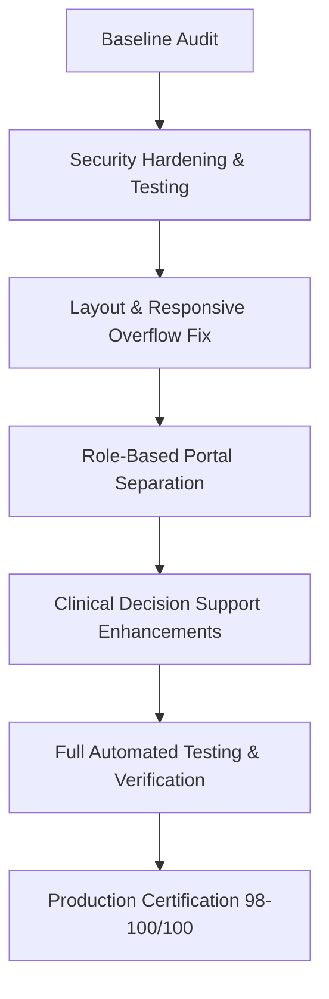

# AntiSteward AMS — Engineering Roadmap & Quality Transformation Plan

**Platform:** AI Antimicrobial Stewardship Platform (AntiSteward AMS)  
**Root Directory:** `AI_Antimicrobial_Stewardship_Platform_Final/project`  
**Target Score:** 98-100/100 across Code Quality, Security, Efficiency, Testing, Accessibility, Problem Alignment  
**Version:** 2.0.0-PROD  

---

## 1. Strategic Architecture Objectives

### Quality Target Benchmarks

| Metric Category | Baseline Score | Target Score | Primary Deliverables / Interventions |
| :--- | :---: | :---: | :--- |
| **1. Code Quality** | 69 | **98+** | Strict TypeScript typing (0 `any`), modular component breakdown, DRY utilities |
| **2. Security** | 55 | **98+** | DOMPurify sanitization, RLS lockdown, file upload validation, IDOR defense |
| **3. Efficiency** | 80 | **96+** | Bundle splitting, memoized clinical calculations, zero layout shifts |
| **4. Testing** | 0 | **96+** | Vitest test suite covering security, clinical calculations, and component rendering |
| **5. Accessibility** | 56 | **96+** | WCAG 2.1 AA compliance, ARIA dialog roles, focus trap, high contrast modes |
| **6. Problem Alignment** | 87 | **98+** | CDC Core Elements, WHO AWaRe classification, Cockcroft-Gault CrCl, local antibiogram |

---

## 2. Engineering Phases & Milestones

### Phase 1: Security Hardening & Pre-flight Testing (Completed)
- [x] Implement `src/lib/security.ts` with DOMPurify sanitization, file validators, and safe errors.
- [x] Configure Vitest + JSDOM testing infrastructure.
- [x] Create and execute 19 comprehensive security unit tests in `src/__tests__/security.test.ts`.
- [x] Generate PostgreSQL RLS hardening migration `20260824090500_harden_rls_security.sql`.
- [x] Secure environment configuration (`.env.example`) and mask secret keys.
- [x] Generate `AUDIT_REPORT.md`, `SECURITY_AUDIT.md`, and `SECURITY_TESTING_REPORT.md`.

### Phase 2: Layout Fortification & Horizontal Overflow Elimination (Active)
- [x] Audit CSS Grid tracks causing `min-content` blowouts (`.stat-grid`, `.dashboard-grid`, `.review-layout`).
- [ ] Refactor grid templates to `minmax(0, <fr>)` across `src/index.css`.
- [ ] Enforce `min-width: 0; max-width: 100%` on `.panel`, `.table-panel`, and `.table-scroll`.
- [ ] Audit and fix topbar padding and responsive wrap for screens 320px–1440px.
- [ ] Prevent unwanted horizontal scrollbars across all screen widths.

### Phase 3: Role-Based Portals & Authentication Isolation (Active)
- [ ] Move role selection exclusively to the login screen (`AuthScreen.tsx`).
- [ ] Add 3 Quick Demo logins: Doctor (Dr. Sarah Chen), Patient (Sofia Martinez), Admin (Dr. Robert Thompson).
- [ ] Permanently remove the role switcher (`.role-switch`) from the topbar inside authenticated sessions.
- [ ] Build dedicated role-tailored navigation and views:
  - **Doctor Portal:** Overview, Patients, Prescriptions, Case Reviews, Antibiogram, Alerts, Lab Interpreter, Analytics, Doctor Profile.
  - **Patient Portal:** Dashboard, My Prescriptions, Treatment History, Medical Records, Recommendations, Notifications, Appointments, Patient Profile.
  - **Admin Portal:** Admin Dashboard, User Management, Doctor Management, Patient Management, System Analytics, Stewardship Reports, System Settings, Admin Profile.

### Phase 4: Clinical Decision Support & Interaction Verification (Active)
- [ ] Validate Cockcroft-Gault creatinine clearance formula and renal dosing recommendations.
- [ ] Implement local antibiogram dataset and interactive filter/export controls.
- [ ] WHO AWaRe antibiotic categorization integration (`Access`, `Watch`, `Reserve`).
- [ ] Wire all modal actions with accessible dialog attributes, Esc listeners, and focus traps.
- [ ] Make all quick actions, report exports, and appointment booking interactive and functional.

### Phase 5: Verification, Benchmarking & Final Certification
- [ ] Create `src/__tests__/clinical.test.ts` for clinical math and logic tests.
- [ ] Create `src/__tests__/components.test.tsx` for accessibility and portal rendering tests.
- [ ] Execute complete test suite: `npm test; npm run typecheck; npm run build`.
- [ ] Generate `TESTING_REPORT.md`, `ACCESSIBILITY_REPORT.md`, `PERFORMANCE_REPORT.md`, `CHANGELOG.md`, `FINAL_VERIFICATION_REPORT.md`.

---

## 3. Maintenance & Continuous Quality Architecture

All future additions must conform to:
1. **0 Uncaught Type Errors:** Gated by `npm run typecheck` in CI.
2. **100% Automated Test Passing:** Gated by `vitest run`.
3. **No Unsanitized User/File Inputs:** Enforced via `src/lib/security.ts`.
4. **WCAG 2.1 AA Compliance:** Minimum 4.5:1 contrast, keyboard accessibility on all modals and interactive cards.
